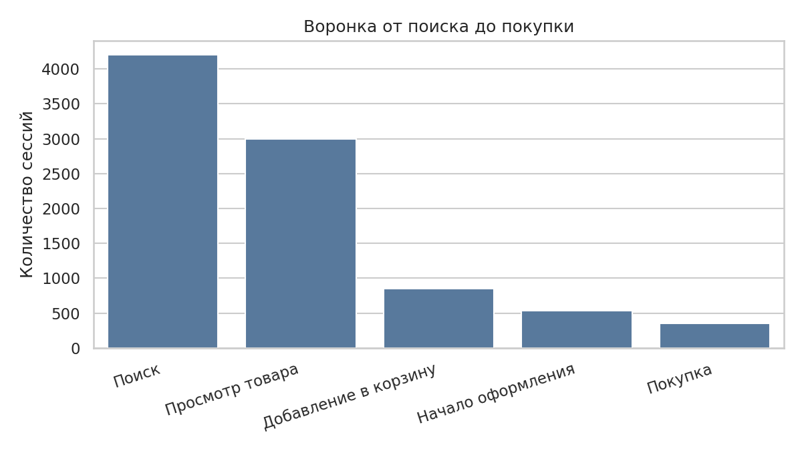
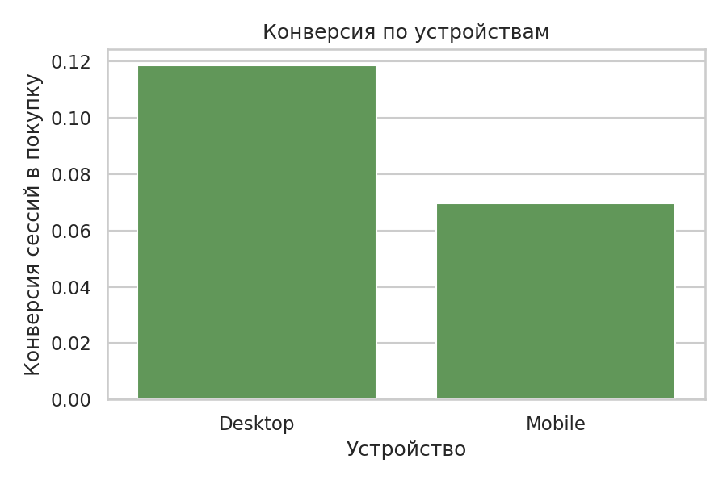

# Воронка маркетплейса: от поиска до покупки

Анализирую, как сессии проходят путь от поискового запроса до покупки. Основная цель — найти этап с наибольшей потерей сессий и сравнить конверсию между устройствами.

**Данные синтетические:** это учебная модель событий, а не статистика реального маркетплейса.

## Что анализируется

- качество таблиц сессий и событий;
- воронка `Search → Product View → Add to Cart → Checkout → Purchase`;
- конверсия между соседними шагами;
- потери сессий на каждом этапе;
- конверсия в покупку по устройству, каналу привлечения и категории товара.

Единица анализа — сессия. У одного пользователя может быть несколько сессий.

## Результаты

| Метрика | Значение |
|---|---:|
| Сессии | 4 200 |
| Пользователи | 2 111 |
| Сессии с покупкой | 351 |
| Конверсия сессии в покупку | 8,4% |
| Конверсия Desktop | 11,8% |
| Конверсия Mobile | 7,0% |

Наибольшая потеря происходит между просмотром товара и добавлением в корзину: 2 144 сессии, или 71,6% сессий с просмотром товара. Разница между Desktop и Mobile составляет около 4,9 п.п.

Это повод проверить мобильную карточку товара и сценарий добавления в корзину — например, ошибки, скорость загрузки и доступность кнопки. Данные показывают, где искать проблему, но не объясняют её причину.





## Структура

- `notebooks/01_marketplace_funnel_analysis.ipynb` — анализ и визуализации.
- `sql/01_funnel_and_segments.sql` — SQL-запросы для расчёта воронки и сегментов.
- `data/sessions.csv`, `data/events.csv` — исходные таблицы.
- `reports/tables/` и `reports/figures/` — результаты расчётов и графики.

## Запуск

```bash
pip install -r requirements.txt
jupyter notebook
```

Откройте `notebooks/01_marketplace_funnel_analysis.ipynb` и выполните ячейки сверху вниз.

Для SQL-части импортируйте `sessions.csv` и `events.csv` в PostgreSQL как таблицы `sessions` и `events`, затем запустите `sql/01_funnel_and_segments.sql`.

## Ограничения

Воронка строится по наличию события в сессии. Повторные действия внутри сессии и временные интервалы между шагами отдельно не учитываются. Сегментные различия описательные и не доказывают причинность. Все результаты относятся только к синтетической выборке.
